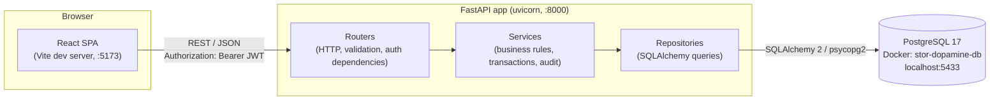
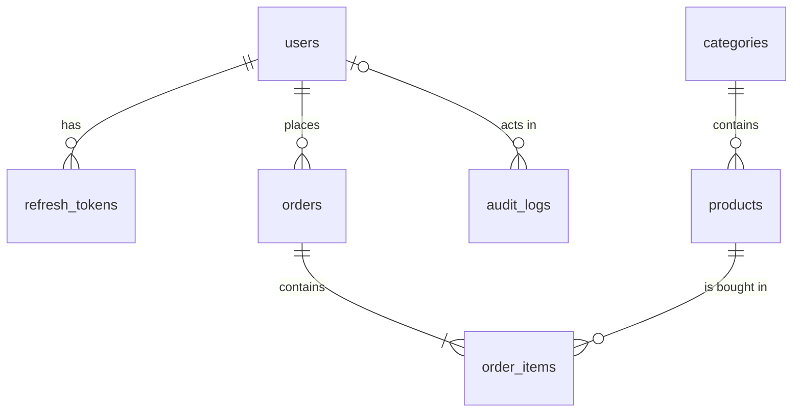

# DopamineStore

DopamineStore is a web simulator of online shopping. It goes through the whole
e-commerce flow (catalog, cart, checkout, payment, parcel tracking), but every
purchase is paid with virtual **Dopamine Points (DP)**. Real payments are not
possible by design.

## Why it exists: mindful shopping

For people prone to impulse buying, much of the reward comes from choosing,
adding to the cart, "paying" and waiting for the parcel, not from owning the
item. DopamineStore gives them that experience without the financial
consequences. Every simulated purchase also increases a **"real money saved"**
counter, which the savings dashboard shows as positive reinforcement.

- Every account starts with **100 000 DP** (`virtual_balance`).
- A successful order moves its total from `virtual_balance` to
  `total_saved_amount`. Both changes happen in one ACID transaction.
- Users can reset their balance back to 100 000 DP at any time. Savings are
  kept, and every reset is recorded in the audit log.

A detailed project description (in Polish) is in
[docs/DopamineStore — Opis projektu.md](docs/DopamineStore%20—%20Opis%20projektu.md).
A presentation script is in [docs/DEMO.md](docs/DEMO.md).

## Features

**Shoppers (client role)**

- Registration and login (JWT access token plus rotating refresh token; the
  frontend refreshes the access token automatically on 401).
- Catalog with search by title, category filter, price range, sorting and
  pagination.
- Product page and a client-side cart (stored in `localStorage` per user).
- Checkout with a shipping address. The test card form is client-side only;
  no card data is sent to the backend. Orders are idempotent through the
  `Idempotency-Key` header.
- Order history and order details.
- Parcel tracking by tracking number (`DS-XXXXXXXXXX`) with a four-step
  timeline (Created → Processing → In transit → Delivered).
- Savings dashboard: total saved, balance, order statistics, spending by
  category, a 30-day chart and a week-over-week comparison.
- Balance reset to 100 000 DP on the profile page.
- **DopaBot** chat assistant (see [below](#dopabot-a-rule-based-chat-assistant)):
  answers questions about the balance, savings and the latest parcel with the
  user's real data, and gives tips against impulse buying.

**Administrators (admin role)**

- Product management: create, edit and deactivate products (soft delete), with
  search and an active/inactive filter.
- Audit log viewer with filters by action, entity type, actor and date range.
- Store-wide analytics: users, orders, revenue, orders by status, top products,
  top categories and orders per day.

**Planned (not implemented)**

- Cloud deployment (Vercel, Render, Supabase) as described in the project
  document.

## Tech stack

| Layer | Technology |
| --- | --- |
| Frontend | React 19, Vite, Tailwind CSS v4, React Router 7, Axios |
| Backend | Python 3.12, FastAPI, SQLAlchemy 2, Alembic, Pydantic |
| Auth | PyJWT (HS256 access tokens), bcrypt password hashing |
| Database | PostgreSQL 17 in Docker (`docker-compose.yml`) |
| Tests | pytest, FastAPI `TestClient` (httpx) |

## Architecture



- **Routers** (`app/routers`) declare endpoints, parse input with Pydantic
  schemas (`app/schemas`) and apply the auth and role dependencies
  (`app/auth.py`).
- **Services** (`app/services`) hold the business logic and own the
  transactions (commit and rollback).
- **Repositories** (`app/repositories`) contain only queries and never commit.
- All errors use one JSON format, `{"error": {"code", "message", "details",
  "request_id"}}`, and every response carries an `X-Request-ID` header
  (`app/core/errors.py`).
- CORS allows the Vite dev origin `http://localhost:5173`.

## Project structure

```text
stor_dopamine/
├── README.md
├── docs/
│   ├── DEMO.md                         # presentation script
│   └── DopamineStore — Opis projektu.md
├── backend/
│   ├── app/
│   │   ├── main.py                     # FastAPI app, CORS, router registration
│   │   ├── database.py                 # engine, SessionLocal, get_db
│   │   ├── models.py                   # SQLAlchemy models (7 tables)
│   │   ├── auth.py                     # JWT, refresh tokens, require_role
│   │   ├── core/                       # constants, unified error handling
│   │   ├── routers/                    # HTTP endpoints
│   │   ├── schemas/                    # Pydantic request/response models
│   │   ├── services/                   # business logic and transactions
│   │   └── repositories/               # database queries
│   ├── alembic/                        # migrations (3 revisions)
│   ├── tests/                          # pytest suite (144 tests)
│   ├── seed.py                         # demo categories and products
│   ├── docker-compose.yml              # PostgreSQL 17 container
│   ├── requirements.txt
│   ├── requirements-dev.txt
│   ├── pytest.ini
│   └── .env.example
└── frontend/
    ├── src/
    │   ├── api.js                      # Axios client, token refresh on 401
    │   ├── App.jsx                     # routes
    │   ├── context/                    # AuthContext, CartContext
    │   ├── pages/                      # shop, checkout, tracking, dashboard, admin…
    │   ├── components/
    │   └── mocks/                      # legacy mock data, no longer used by the app
    ├── package.json
    └── vite.config.js
```

## Running locally (Windows, cmd)

Requirements: Docker Desktop, Python 3.12, Node.js (LTS) with npm.

### 1. Database (Docker)

```bat
cd backend
docker compose up -d
docker ps
```

`docker ps` should list the container `stor-dopamine-db` with port
`0.0.0.0:5433->5432/tcp`. The database is `dopaminestore` and the user is
`dopamine`; see `docker-compose.yml`.

### 2. Backend

All commands run from the `backend` folder:

```bat
python -m venv venv
venv\Scripts\activate
pip install -r requirements.txt
copy .env.example .env
```

Edit `.env` and replace the placeholders (see
[Environment variables](#environment-variables)). Then create the schema, load
the demo data and start the API:

```bat
alembic upgrade head
python seed.py
uvicorn app.main:app --reload
```

`seed.py` adds 4 categories and 8 products. It does nothing if categories
already exist.

### 3. Frontend

In a second terminal:

```bat
cd frontend
npm install
npm run dev
```

### Addresses

| What | URL |
| --- | --- |
| Website | http://localhost:5173 |
| Swagger UI (interactive API docs) | http://127.0.0.1:8000/docs |
| Health check | http://127.0.0.1:8000/api/health |

The frontend calls `http://127.0.0.1:8000` by default. Set `VITE_API_URL` to
use a different backend address.

### Making a user an admin

Register a user in the UI, then change their role directly in the database:

```bat
docker exec -it stor-dopamine-db psql -U dopamine -d dopaminestore -c "UPDATE users SET role='admin' WHERE email='admin@test.com';"
```

Log out and log in again. The **Admin panel** link then appears in the header
menu.

## Environment variables

The backend reads them from `backend/.env` (see
[`backend/.env.example`](backend/.env.example)). Do not commit `.env`; it is
listed in `.gitignore`.

| Variable | Required | Default | Description |
| --- | --- | --- | --- |
| `DATABASE_URL` | yes | – | PostgreSQL URL, e.g. `postgresql://dopamine:<password>@localhost:5433/dopaminestore` |
| `JWT_SECRET` | yes | – | Secret for signing access tokens (HS256) |
| `ACCESS_TOKEN_MINUTES` | no | `30` | Access token lifetime in minutes |
| `REFRESH_TOKEN_DAYS` | no | `7` | Refresh token lifetime in days |
| `TEST_DATABASE_URL` | no | derived | Tests only: overrides the test database URL (the name must end with `_test`) |
| `VITE_API_URL` | no | `http://127.0.0.1:8000` | Frontend only: backend base URL |

## Tests

From the `backend` folder, with the venv activated and the database container
running:

```bat
pip install -r requirements-dev.txt
pytest -q
```

The suite has 144 tests and runs in about a minute.

- It never touches the dev database. `tests/conftest.py` takes
  `DATABASE_URL`, replaces the database name with `dopaminestore_test` (or uses
  `TEST_DATABASE_URL`) and asserts that the name ends with `_test`. It then
  drops and recreates that database, runs `alembic upgrade head` and seeds it.
  It also points the app at that database before the app is imported.
- `audit_logs` is append-only, so tables are never cleaned between tests. Each
  test creates its own users (uuid-based emails) and products instead.

| Module | Covers |
| --- | --- |
| `test_auth.py` | register, case-insensitive duplicate email, login, wrong password, refresh rotation, logout, `/me` without a token |
| `test_products.py` | catalog list, search, category filter, product by id, 404 |
| `test_checkout.py` | order totals and tracking number format, idempotent replay, insufficient funds, unavailable products, server-side prices, **concurrent checkout race** |
| `test_orders_tracking.py` | own orders only, `compute_status` boundaries (29/30 s, 599/600 s, 7199/7200 s), tracking after shifting `created_at`, status never goes back |
| `test_rbac_admin.py` | 401/403/200 on admin endpoints, product create/update/delete audit entries, deactivated product hidden from the catalog, log filters, `INVALID_DATE_RANGE`, analytics keys |
| `test_audit_immutability.py` | direct `UPDATE`/`DELETE` on `audit_logs` fails; `ORDER_CREATED` is written once per idempotency key |
| `test_chat.py` | DopaBot: 401/422, intent and language detection with priorities, replies with real balance, savings and latest order, read-only status, 24-hour rule, deterministic tips, suggestions, nothing written to the audit log |
| `test_balance_reset.py` | reset to 100 000, savings kept, `NOTHING_TO_RESET`, `BALANCE_RESET` audit entry |

## API

All endpoints are under `/api`. This table is generated from the app's
OpenAPI schema (`app.openapi()`); Swagger at `/docs` shows the full request
and response models.

Roles: **Public**: no token needed. **User**: any signed-in user (client or
admin), via `Authorization: Bearer <access_token>`. **Admin**: `admin` role
only. Without a token the API returns 401; with a wrong role it returns 403
`FORBIDDEN`.

| Method | Path | Role | Description |
| --- | --- | --- | --- |
| GET | `/api/health` | Public | Liveness check, returns `{"status": "ok"}` |
| POST | `/api/auth/register` | Public | Create an account (email, password ≥ 8 chars with a letter and a digit). 201; 409 `EMAIL_ALREADY_EXISTS` |
| POST | `/api/auth/login` | Public | Returns an access and refresh token pair. 401 `INVALID_CREDENTIALS` |
| POST | `/api/auth/refresh` | Public (refresh token in body) | Rotates the refresh token: the old one is revoked and a new pair is issued |
| POST | `/api/auth/logout` | Public (refresh token in body) | Revokes the refresh token. 204 |
| GET | `/api/auth/me` | User | Current user: id, email, role, `virtual_balance`, `total_saved_amount` |
| GET | `/api/categories` | Public | Categories with active product counts |
| GET | `/api/products` | Public | Active products: `page`, `page_size`, `category` (slug), `q`, `min_price`, `max_price`, `sort` |
| GET | `/api/products/{product_id}` | Public | One active product. 404 `PRODUCT_NOT_FOUND` |
| POST | `/api/orders` | User | Checkout. Requires the `Idempotency-Key` header. 201 new order, 200 replay of the same key; 400 `INSUFFICIENT_FUNDS`, 409 `PRODUCT_UNAVAILABLE` |
| GET | `/api/orders` | User | Own order history, newest first, paginated |
| GET | `/api/orders/{order_id}` | User | Own order details with lines. 404 `ORDER_NOT_FOUND` |
| GET | `/api/orders/track/{tracking_number}` | User | Parcel status and timeline of an own order. 404 `TRACKING_NOT_FOUND` |
| GET | `/api/analytics/savings` | User | Savings dashboard data; `days` sets the chart window |
| POST | `/api/users/me/balance/reset` | User | Reset balance to 100 000 DP. 409 `NOTHING_TO_RESET` |
| POST | `/api/chat` | User | DopaBot rule-based chat: `{"message"}` (1–500 chars after trim) → `{"reply", "intent", "suggestions"}`. 422 for an empty or too long message |
| GET | `/api/admin/products` | Admin | All products incl. inactive; `q`, `is_active`, pagination |
| POST | `/api/admin/products` | Admin | Create a product (audited: `PRODUCT_CREATED`) |
| PATCH | `/api/admin/products/{product_id}` | Admin | Partial update; only changed fields are audited (`PRODUCT_UPDATED`) |
| DELETE | `/api/admin/products/{product_id}` | Admin | Soft delete: deactivates the product (`PRODUCT_DELETED`). 204 |
| GET | `/api/admin/logs` | Admin | Audit log: `action`, `entity_type`, `actor`, `date_from`, `date_to`, pagination. 422 `INVALID_DATE_RANGE` |
| GET | `/api/admin/logs/actions` | Admin | Distinct action names for the filter |
| GET | `/api/admin/analytics` | Admin | Store-wide statistics; `days` sets the period |

## Database

PostgreSQL 17. The schema is managed by Alembic (3 revisions in
`backend/alembic/versions`): the initial schema, orders and order items, and
the audit log.



| Table | Purpose | Key constraints |
| --- | --- | --- |
| `categories` | Product categories | `name` UNIQUE, `slug` UNIQUE |
| `users` | Accounts with role and virtual balance | UUID PK; unique index on `lower(email)` (case-insensitive); CHECK `role IN ('client','admin')`; CHECK `virtual_balance >= 0`; CHECK `total_saved_amount >= 0`; default balance `100000.00` |
| `products` | Catalog | FK `category_id → categories` ON DELETE RESTRICT; CHECK `price > 0`; `is_active` flag for soft delete; index `(is_active, category_id)` |
| `refresh_tokens` | Refresh tokens (SHA-256 hash only) | FK `user_id → users` ON DELETE CASCADE; `token_hash` UNIQUE; `expires_at`, `revoked_at` |
| `orders` | Orders | FK `user_id → users`; `tracking_number` UNIQUE; UNIQUE `(user_id, idempotency_key)`; CHECK `total_price > 0`; CHECK `status IN ('CREATED','PROCESSING','IN_TRANSIT','DELIVERED')`; `shipping_address` JSONB; index `(user_id, created_at DESC)` |
| `order_items` | Order lines with the price at purchase time | FK `order_id → orders` ON DELETE CASCADE; FK `product_id → products` ON DELETE RESTRICT; CHECK `quantity BETWEEN 1 AND 99`; CHECK `price_at_purchase > 0`; UNIQUE `(order_id, product_id)` |
| `audit_logs` | Append-only event log | BIGINT PK; FK `actor_user_id → users` with no ON DELETE action (a user with log entries cannot be deleted); `actor_email` snapshot; `details` JSONB; indexes on `created_at DESC`, `action`, `actor_user_id`; **triggers** `audit_logs_no_update_delete` (BEFORE UPDATE OR DELETE, per row) and `audit_logs_no_truncate` (BEFORE TRUNCATE) raise `audit_logs is append-only` |

## Key engineering decisions

### ACID checkout

`order_service.place_order` handles a whole checkout in **one transaction**:

1. **Idempotency.** The client sends an `Idempotency-Key` header (8–64
   chars). If an order with that key already exists for the user, it is
   returned with status 200 and nothing is charged again. The key is checked a
   second time under the lock, and the UNIQUE `(user_id, idempotency_key)`
   constraint catches any remaining race.
2. **Row lock.** `SELECT … FOR UPDATE` on the user row serializes concurrent
   checkouts of the same user, so two parallel orders cannot both spend the
   same balance.
3. **Server-side prices.** The request contains only product ids and
   quantities. Prices are read from the database, the total is recalculated,
   and any price fields sent by the client are ignored. Inactive or missing
   products give 409 `PRODUCT_UNAVAILABLE`.
4. **One commit.** The order, its items (with `price_at_purchase`), the balance
   debit, the `total_saved_amount` increase and the `ORDER_CREATED` audit entry
   are committed together, or everything is rolled back. The CHECK
   `virtual_balance >= 0` is a last line of defence in the database.

### Authentication: JWT access + rotating refresh tokens

- **Access token.** A short-lived JWT (HS256, default 30 min) with `sub`
  (user id), `role`, `iat` and `exp`.
- **Refresh token.** A random 48-byte URL-safe string (default 7 days). The
  database stores only its **SHA-256 hash**, so a leaked table does not expose
  usable tokens.
- **Rotation.** Every `/api/auth/refresh` revokes the presented token
  (`revoked_at`) under a row lock and issues a new pair, so a refresh token
  works only once. `/api/auth/logout` revokes the token.
- **Passwords.** Hashed with bcrypt. Login returns the same
  `INVALID_CREDENTIALS` error for an unknown email and for a wrong password.

### Role-based access control

`require_role("admin")` is a FastAPI dependency on every `/api/admin/*`
endpoint. The user and role are loaded from the database on each request, not
only from the token, so a role change takes effect immediately. Missing or
invalid tokens give 401, and the wrong role gives 403 `FORBIDDEN`. Users only
ever see their own orders: other users' orders and parcels return 404, so
their existence is not revealed.

### Append-only audit log

Audit entries are written by `audit_service.record` **inside the same
transaction** as the business change, so an entry exists if and only if the
change was committed. Recorded actions: `ORDER_CREATED`, `BALANCE_RESET`,
`PRODUCT_CREATED`, `PRODUCT_UPDATED` (with old/new values of changed fields)
and `PRODUCT_DELETED`. Each entry stores the actor id, an email snapshot, the
entity, JSON details and the request id. PostgreSQL triggers reject every
`UPDATE`, `DELETE` and `TRUNCATE` on the table, so even direct SQL cannot
rewrite history.

### Parcel status derived from time

There is no background worker. `tracking_service.compute_status` derives the
status from the time elapsed since `created_at`:

| Elapsed | Status |
| --- | --- |
| < 30 s | `CREATED` |
| ≥ 30 s | `PROCESSING` |
| ≥ 10 min | `IN_TRANSIT` |
| ≥ 2 h | `DELIVERED` |

When an order or parcel is read, the computed status is saved to the database
if it moved forward. It never goes back: the reported status is never earlier
than the stored one. The thresholds are constants at the top of
`backend/app/services/tracking_service.py`.

### Test suite with a race test

144 pytest tests run against an isolated, automatically recreated test database
(see [Tests](#tests)). Besides the happy paths and error codes, the suite
includes a **concurrency test**. Two threads start a checkout at the same
moment for the same user, each costing 60 000 DP of the 100 000 balance. The
test checks that exactly one gets 201 and the other gets
`INSUFFICIENT_FUNDS`, and that the final balance is 40 000. Other tests
confirm through real SQL that the audit log cannot be modified.

### DopaBot: a rule-based chat assistant

DopaBot (`POST /api/chat`, `app/services/chat_service.py`) is deliberately
**not** an AI: it uses no external AI or LLM services and needs no API keys.

- `detect_intent` is a pure function. It matches Ukrainian and English
  keywords and picks one of the intents `impulse`, `last_order`, `savings`,
  `balance`, `tips`, `about`, `help`, `thanks` or `greeting` in that priority
  order, or `unknown` if nothing matches. The reply is in Ukrainian if the
  message contains Cyrillic, otherwise in English.
- Replies use the current user's real data: balance (with a reset hint below
  10 000 DP), savings and order count, and the latest order with its tracking
  number, total, item count and computed status. Status is computed for
  display only, so the chat never writes to the database.
- For impulse urges it asks three reflective questions and suggests the
  24-hour rule. Tips come from a fixed list, chosen deterministically from the
  message text.
- **Privacy:** chat history is not stored on the server, not written to the
  audit log and messages are not logged. In the browser, the conversation
  lives only in the widget's state and disappears on page reload.
